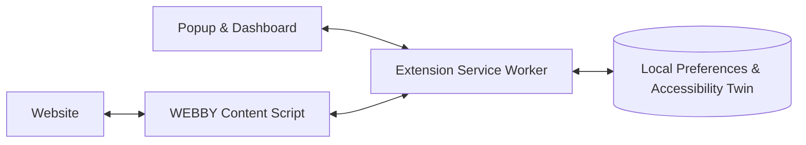

<p align="center">
  
</p>

<h1 align="center">WEBBY</h1>

<p align="center">
  <strong>Adaptive accessibility for the web.</strong><br />
  A browser extension that makes websites easier to use, on your terms.
</p>

<p align="center">
  
  
  
  
</p>

<p align="center"><em>“Don't adapt yourself to the website. Let the website adapt to you.”</em></p>

---

## What is WEBBY?

Most websites offer the same reading experience to everyone. **WEBBY changes that.** It lets people adjust text, contrast, spacing, motion, and focus to suit their preferences—directly on the websites they already visit.

WEBBY remembers these choices, supports website-specific settings, and provides a rule-based **Accessibility Twin** that responds to explicit user feedback. **AI is not currently integrated.** AI-assisted webpage analysis and recommendations are planned as a future extension.

**No account required. No database required. Current accessibility features use local, rule-based logic.**

## Features

| | Feature | What it does |
|---|---|---|
| **01** | **Instant website adaptation** | Adjust text size, line spacing, contrast, dark mode, reduced motion, and keyboard focus. |
| **02** | **Personal accessibility profile** | Save default preferences and apply them across websites. |
| **03** | **Per-website customization** | Keep different accessibility settings for different sites. |
| **04** | **Accessibility Twin** | Turn feedback like “text too small” or “need more spacing” into remembered site-specific improvements. |
| **05** | **Privacy and control** | Keep preferences locally and undo or reset adaptations. |

## How it works



The extension applies rule-based changes in the browser and stores preferences locally. The Accessibility Twin uses explicit feedback to adjust site-specific settings; it does not currently use an integrated AI model.

## Getting started

### 1. Install the extension

1. Download or clone this repository.
2. Open `chrome://extensions` in Chrome.
3. Turn on **Developer mode**.
4. Click **Load unpacked** and select the **`extension/`** folder.
5. Pin WEBBY to the toolbar, then open any supported `http://` or `https://` webpage.

Open WEBBY's popup to adjust the current site, or select **Open dashboard** for global preferences, saved sites, Accessibility Twin insights, and privacy settings.

> The extension's current features work without an AI backend. AI integration is planned for a future extension.

### 2. Try the demonstration website

Requires **Node.js 20 or newer**. From the repository root:

```bash
npm run demo
```

Open **http://127.0.0.1:4173**. The included demo intentionally uses difficult-to-read text and animation so you can see WEBBY's adaptations in action.

## Future extension: AI integration

AI-assisted recommendations are **planned, not an implemented feature of the current prototype**. The repository contains backend and AI-related groundwork for future development; these files and any AI-related interface controls do not indicate completed integration.

The planned extension would:

- Analyze a privacy-minimized structural summary of a webpage to suggest context-aware accessibility improvements.
- Require explicit consent and a user-initiated request before sharing page information.
- Exclude raw webpage text, credentials, form values, and HTML from AI requests.
- Restrict recommendations to validated, predefined actions that users can undo.

Completing and validating the connection between the extension, backend, and AI provider remains future work. No API key or AI setup is needed to use the current accessibility features.

## Project structure

```text
WEBBY_Complete_Prototype/
├── extension/
│   ├── manifest.json          # Chrome Manifest V3
│   ├── background.js          # Extension messages and future AI groundwork
│   ├── content.js             # Page analysis and adaptations
│   ├── content.css            # Accessibility styles on webpages
│   ├── popup.*                # Quick-access extension interface
│   ├── dashboard.*            # Full settings dashboard
│   ├── ui.css                 # Shared sap-green UI theme
│   ├── assets/                # Extension icons
│   └── shared/                # Profiles, storage, and Twin logic
├── backend/
│   ├── server.js              # Local API groundwork for future integration
│   ├── ai.js                  # AI groundwork; not currently integrated
│   └── .env.example           # Environment variable reference
├── demo/                      # Accessibility demonstration webpage
├── tests/                     # Automated tests
├── tools/                     # Demo server and code validation
├── docs/                      # Architecture, API, security, and handoff
└── package.json
```

## Commands

| Command | Purpose |
|---|---|
| `npm run demo` | Serve the demonstration website on port `4173` |
| `npm run server` | Start the development backend on port `3001` (future AI integration groundwork) |
| `npm run check` | Validate JavaScript syntax and extension metadata |
| `npm test` | Run automated tests |
| `npm run verify` | Run checks and automated tests together |

The project uses built-in Node.js functionality and has **no third-party npm dependencies**.

## Privacy by design

- **Local-first:** Preferences, website overrides, and Twin feedback are stored in `chrome.storage.local`.
- **Reversible changes:** Users can disable adjustments or reset website preferences.

Consent, minimal data sharing, and constrained AI recommendations are design requirements for the planned AI extension, not claims of completed AI integration.

**Important:** The included backend is configured for local development and does not provide authentication or rate limiting. Secure it before exposing AI endpoints publicly. Website compatibility and accessibility outcomes should be verified on real pages; WEBBY is not a substitute for a full accessibility audit.

## Documentation

- [Architecture](docs/ARCHITECTURE.md) — components and data flow
- [API contract](docs/API_CONTRACT.md) — requests, responses, and permitted actions
- [Security and privacy](docs/SECURITY.md) — safeguards and limitations
- [Testing guide](docs/TESTING.md) — validation and browser QA
- [Original proposal](docs/ORIGINAL_PROPOSAL.pdf) — project concept and vision

---

<p align="center"><strong>WEBBY</strong> · The web should adapt to you.</p>
