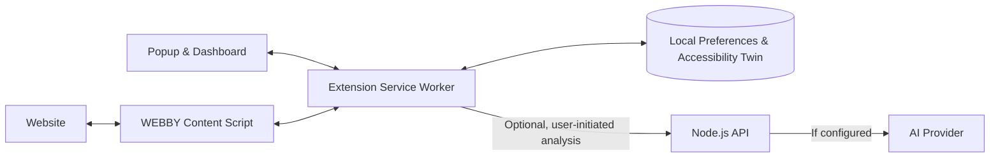

<p align="center">
  
</p>

<h1 align="center">WEBBY</h1>

<p align="center">
  <strong>AI-powered adaptive accessibility for the web.</strong><br />
  A browser extension that makes websites easier to use, on your terms.
</p>

<p align="center">
  
  
  
  
</p>

<p align="center"><em>“Don't adapt yourself to the website. Let the website adapt to you.”</em></p>

---

## What is WEBBY?

Most websites offer the same reading experience to everyone. **WEBBY changes that.** It lets people adjust text, contrast, spacing, motion, and focus to suit their preferences—directly on the websites they already visit.

WEBBY remembers these choices, supports website-specific settings, and provides an **Accessibility Twin** that responds to explicit user feedback. An optional AI engine can analyze a privacy-minimized description of a webpage and recommend safe, reversible improvements.

**No account required. No database required. Core accessibility controls work without AI.**

## Features

| | Feature | What it does |
|---|---|---|
| **01** | **Instant website adaptation** | Adjust text size, line spacing, contrast, dark mode, reduced motion, and keyboard focus. |
| **02** | **Personal accessibility profile** | Save default preferences and apply them across websites. |
| **03** | **Per-website customization** | Keep different accessibility settings for different sites. |
| **04** | **Accessibility Twin** | Turn feedback like “text too small” or “need more spacing” into remembered site-specific improvements. |
| **05** | **AI-assisted recommendations** | With consent, request context-aware suggestions from an optional backend. |
| **06** | **Privacy and control** | Keep preferences locally, validate AI actions, and undo or reset adaptations. |

## How it works



The extension applies rule-based changes in the browser. If AI analysis is enabled, WEBBY sends a **sanitized structural summary** rather than raw webpage text, form values, or HTML. Suggested actions are restricted to a predefined allowlist and validated before they are applied.

## Getting started

### 1. Install the extension

1. Download or clone this repository.
2. Open `chrome://extensions` in Chrome.
3. Turn on **Developer mode**.
4. Click **Load unpacked** and select the **`extension/`** folder.
5. Pin WEBBY to the toolbar, then open any supported `http://` or `https://` webpage.

Open WEBBY's popup to adjust the current site, or select **Open dashboard** for global preferences, saved sites, Accessibility Twin insights, and privacy settings.

> The extension's core features work immediately. The AI backend is optional.

### 2. Try the demonstration website

Requires **Node.js 20 or newer**. From the repository root:

```bash
npm run demo
```

Open **http://127.0.0.1:4173**. The included demo intentionally uses difficult-to-read text and animation so you can see WEBBY's adaptations in action.

### 3. Enable optional AI recommendations

Start the local backend in a separate terminal:

```bash
npm run server
```

The API will be available at **http://127.0.0.1:3001**; its health endpoint is `/api/health`.

For real AI-generated recommendations, provide an OpenAI API key **to the backend process** before starting it:

**Windows PowerShell**

```powershell
$env:OPENAI_API_KEY="YOUR_API_KEY"
$env:OPENAI_MODEL="gpt-4o-mini"
npm run server
```

**macOS / Linux**

```bash
export OPENAI_API_KEY="YOUR_API_KEY"
export OPENAI_MODEL="gpt-4o-mini"
npm run server
```

In the extension, enable **AI analysis consent** and select **Analyze this page**. If the server or key is unavailable, WEBBY uses a clearly identified rule-based fallback.

> **Never commit an API key** or place one in the Chrome extension. The sample `backend/.env.example` documents the variables; `.env` files are not automatically loaded by this project.

## Project structure

```text
WEBBY_Complete_Prototype/
├── extension/
│   ├── manifest.json          # Chrome Manifest V3
│   ├── background.js          # Extension messages and AI requests
│   ├── content.js             # Page analysis and adaptations
│   ├── content.css            # Accessibility styles on webpages
│   ├── popup.*                # Quick-access extension interface
│   ├── dashboard.*            # Full settings dashboard
│   ├── ui.css                 # Shared sap-green UI theme
│   ├── assets/                # Extension icons
│   └── shared/                # Profiles, storage, and Twin logic
├── backend/
│   ├── server.js              # Local JSON API
│   ├── ai.js                  # AI recommendations and fallback
│   └── .env.example           # Environment variable reference
├── demo/                      # Accessibility demonstration webpage
├── tests/                     # Automated tests
├── tools/                     # Demo server and code validation
├── docs/                      # Architecture, API, security, and handoff
└── package.json
```

## Commands

| Command | Purpose |
|---|---|
| `npm run demo` | Serve the demonstration website on port `4173` |
| `npm run server` | Start the local AI backend on port `3001` |
| `npm run check` | Validate JavaScript syntax and extension metadata |
| `npm test` | Run automated tests |
| `npm run verify` | Run checks and automated tests together |

The project uses built-in Node.js functionality and has **no third-party npm dependencies**.

## Privacy by design

- **Local-first:** Preferences, website overrides, and Twin feedback are stored in `chrome.storage.local`.
- **User-controlled AI:** Analysis requires consent and a user-initiated action.
- **Minimal data sharing:** AI analysis uses structural page information, not raw text, credentials, form input, or HTML.
- **Constrained recommendations:** AI output cannot inject arbitrary JavaScript, HTML, or CSS.
- **Reversible changes:** Users can disable adjustments or reset website preferences.

**Important:** The included backend is configured for local development and does not provide authentication or rate limiting. Secure it before exposing AI endpoints publicly. Website compatibility and accessibility outcomes should be verified on real pages; WEBBY is not a substitute for a full accessibility audit.

## Documentation

- [Architecture](docs/ARCHITECTURE.md) — components and data flow
- [API contract](docs/API_CONTRACT.md) — requests, responses, and permitted actions
- [Security and privacy](docs/SECURITY.md) — safeguards and limitations
- [Testing guide](docs/TESTING.md) — validation and browser QA
- [LLM handoff](docs/LLM_HANDOFF.md) — context for contributors and AI coding assistants
- [Original proposal](docs/ORIGINAL_PROPOSAL.pdf) — project concept and vision

---

<p align="center"><strong>WEBBY</strong> · The web should adapt to you.</p>
